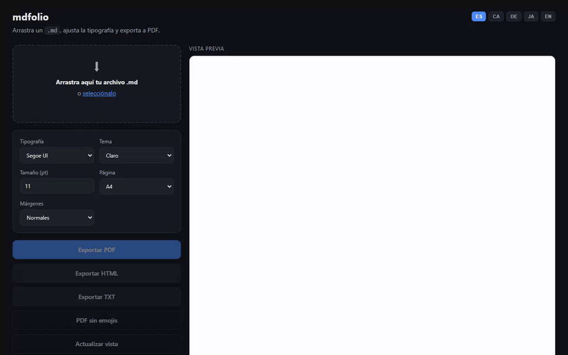

<div align="center">

# XB-41 · MDtoPDF

**Typeset-quality PDFs from Markdown — in under a second, 100% local, no LaTeX, no bundled browser.**

Web UI · CLI · Docker

[](https://github.com/xavbal/XB-41_MDTOPDF/stargazers)
[](LICENSE)
[](https://github.com/xavbal/XB-41_MDTOPDF/commits/main)
[](https://nodejs.org)



[English](README.md) | [Español](README.es.md) | [Català](README.ca.md) | [Deutsch](README.de.md) | [日本語](README.ja.md)

</div>

---

## Quickstart

```bash
git clone https://github.com/xavbal/XB-41_MDTOPDF.git && cd XB-41_MDTOPDF && npm install && npm start
```

Then open **http://localhost:4141**, drop a `.md` and click **Export PDF**.
On Windows you can also double-click **`XB-41 MDtoPDF.bat`**.

## Command line

```bash
npm install -g github:xavbal/XB-41_MDTOPDF
xb41 notes.md --theme sepia --font Georgia
# ✔ notes.pdf  (370 KB, 0.7 s)
```

```
xb41 <file.md> [more.md ...] [options]

  -o, --out <path>     Output file (one input) or directory (several inputs)
  -t, --theme <name>   light | dark | sepia            (default: light)
  -f, --font <name>    Georgia, Garamond, Cambria…     (default: "Segoe UI")
  -s, --size <pt>      Font size                       (default: 11)
  -p, --page <size>    a4 | letter | legal             (default: a4)
  -m, --margins <m>    normal | narrow | wide          (default: normal)
      --no-emoji       Strip emojis before rendering
      --fonts          List available typefaces
```

Batch: `xb41 docs/*.md --out pdf/`. Exit code is non-zero if any file fails, so it drops into scripts and CI.

## Why it's fast and light

Most Markdown→PDF tools either download their own Chromium or need a full TeX distribution.
XB-41 prints through the **Chromium-based Edge that already ships with Windows**, so there is nothing heavy to install.

| | XB-41 | md-to-pdf (Puppeteer) | Pandoc + LaTeX |
|---|---|---|---|
| Time per PDF (2-page doc) | **~0.7–0.8 s** | ~2.1 s warm · ~10 s first run | not measured |
| Install footprint | **1.7 MB** of npm deps | 36.5 MB deps + ~1.2 GB browser cache | ~1 GB (MiKTeX) |
| Live preview | ✅ same engine as the PDF | ❌ | ❌ |
| Runs offline | ✅ | ✅ | ✅ |

<sub>Measured on one Windows 11 machine with the same 2-page Markdown file (`promo/demo/demo.md`), 3 runs each, Oct 2026.
XB-41 time is the CLI run or the `/api/convert` round-trip with the server already running.
On a MacBook Pro M1 Max with Google Chrome the same file takes ~2.1–2.5 s.
The md-to-pdf cache size is the whole Puppeteer cache on that machine and may include more than one browser build.</sub>

## Docker

```bash
git clone https://github.com/xavbal/XB-41_MDTOPDF.git && cd XB-41_MDTOPDF
docker build -t xb41 .
docker run --rm -p 127.0.0.1:4141:4141 xb41          # web UI on http://localhost:4141
docker run --rm -v "$PWD:/work" -w /work xb41 node /app/bin/xb41.mjs notes.md   # CLI
```

The image bundles Chromium and fonts (~1.5 GB). Publish the port on `127.0.0.1` only — the converter renders raw HTML.

## Features

- **Real typography** — curly quotes, proper dashes, hyphenation, page numbers.
- **Three themes** — Light, Dark and Sepia, printed full-bleed. [See an example PDF](docs/example-sepia.pdf).
- **15 typefaces** — Georgia, Garamond, Cambria, Segoe UI, Consolas, Yu Gothic, Noto Sans JP…
- **Export without emojis** — one click for formal documents.
- **PDF, HTML and TXT** export with a native "Save as" dialog.
- **A4 / Letter / Legal**, adjustable font size and margins.
- **UI in 5 languages** — English, Español, Català, Deutsch, 日本語.

## Privacy

Everything runs on your machine: no cloud, no account, no telemetry.

## Requirements

- Node.js 18+
- Microsoft Edge (preinstalled on Windows 11) or Chrome/Chromium. Set `CHROME_BIN` for a custom path.

| Platform | Status |
|---|---|
| Windows 11 | ✅ Tested |
| Linux / Docker | ✅ Tested in the Docker image (Chromium) |
| macOS | ✅ Tested with Google Chrome |

## How it works

| File | Role |
|---|---|
| `src/converter.mjs` | Markdown → HTML with `markdown-it` (typographer) + parametrised print CSS |
| `src/pdf.mjs` | Finds Edge/Chrome and prints HTML to PDF headless, isolated profile per conversion |
| `src/server.mjs` | Zero-framework Node HTTP server for the UI (loopback only) |
| `bin/xb41.mjs` | Command-line interface |
| `src/public/` | The UI — plain HTML/CSS/JS, no frontend dependencies |

## Roadmap

- [x] CLI: `xb41 report.md --theme sepia --font Georgia`
- [ ] Publish to npm (`npx xb41 …`)
- [ ] Local images next to the `.md`
- [x] Docker image (build locally)
- [ ] Prebuilt image on GHCR

Ideas and PRs welcome — [open an issue](https://github.com/xavbal/XB-41_MDTOPDF/issues).

## License

MIT © Xavier Ballester. If XB-41 saved you a LaTeX install, a ⭐ helps others find it.
